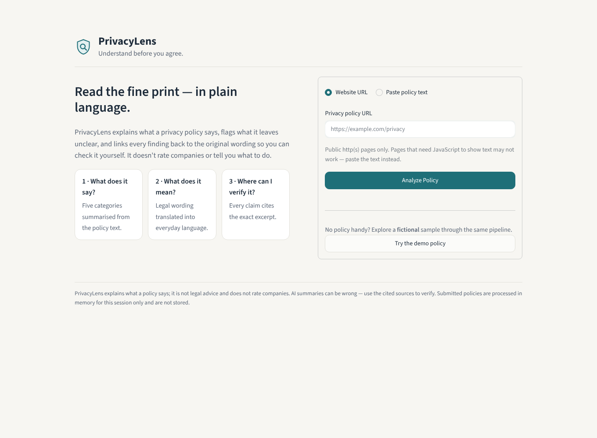
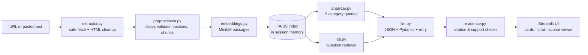

# 🛡️ PrivacyLens

**Understand before you agree.**

PrivacyLens is an AI-powered assistant that explains website privacy policies in plain language, answers questions about them with evidence, and is upfront about what a policy leaves unclear or doesn't say at all. Every finding links back to the exact excerpt it came from.

Its philosophy is **inform, don't persuade**: no privacy scores, no "safe/unsafe" labels, no recommendations about whether to use a service.



---

## The problem

People share personal data with digital services every day, but privacy policies are long and written in legal and technical language. Most people agree without reading. PrivacyLens helps answer three questions:

1. **What does this policy actually say?**
2. **What does that mean in understandable language?**
3. **Where in the original policy can I verify it?**

## Key features

| Feature | What it does |
|---|---|
| **Policy submission** | Paste a public privacy-policy URL or the policy text. URL fetching is SSRF-hardened (see [Security](#security)). |
| **Privacy at a glance** | Five category cards — Data Collection, Data Usage, Data Sharing, Data Retention, User Rights & Choices — each with a plain-language summary, up to three findings, citations, and an evidence status. |
| **Ask the policy** | Chat-style Q&A grounded in retrieved excerpts (RAG). Follow-ups are understood using conversation history, which is never treated as evidence. |
| **Evidence viewer** | Click any `Source N` chip to see the original excerpt, its section heading, source ID and policy URL. A Source viewer tab lets you browse every indexed section. |
| **Uncertainty reporting** | Every finding and answer is labelled **Clearly stated**, **Unclear**, or **Not found**. "Not found" is never presented as proof that a practice doesn't happen. |
| **Citation validation** | Model-cited IDs are checked against the chunks actually retrieved; fabricated IDs are removed, and claims left without valid support are hidden (overview) or flagged as unverified (Q&A). |
| **Demo mode** | A clearly labelled **fictional** policy (Brightleaf Notes) runs through the same pipeline as real submissions — no canned answers. |

## Technology stack

- **UI:** Streamlit (custom CSS, tabs, popovers, chat)
- **Language:** Python 3.11+
- **LLM:** OpenAI Chat Completions in JSON mode; model set by `OPENAI_MODEL`
- **Embeddings:** Sentence Transformers `all-MiniLM-L6-v2`
- **Vector search:** FAISS (`IndexFlatIP` over normalised vectors = cosine similarity)
- **Extraction:** Requests + BeautifulSoup
- **Validation:** Pydantic v2
- **Tests:** Pytest + Streamlit `AppTest`

No database, no authentication, no cloud services beyond the OpenAI API. Policies and indexes live in memory for the current session only.

## System architecture



```text
PrivacyLens/
├── app.py                    # Streamlit UI
├── config.py                 # settings from env vars / Streamlit secrets
├── core/
│   ├── extractor.py          # SSRF-safe fetching, HTML → heading-preserving text
│   ├── preprocessor.py       # cleaning, validation, section detection, chunking
│   ├── embeddings.py         # Sentence-Transformers wrapper
│   ├── retrieval.py          # FAISS index with passage → chunk aggregation
│   ├── llm.py                # OpenAI client, structured output + controlled retry
│   ├── analyzer.py           # ingestion + five-category overview
│   ├── qa.py                 # RAG question answering
│   └── evidence.py           # citation validation, evidence-status enforcement
├── models/schemas.py         # Pydantic schemas for all LLM output
├── prompts/system_prompts.py # grounding rules, injection-safe excerpt formatting
├── data/sample_policy.txt    # FICTIONAL demo policy
├── evaluation/               # annotated questions + metrics script
└── tests/                    # 67 tests (extraction, chunking, retrieval, evidence, pipeline, UI)
```

## Installation

Requires Python 3.11 or newer.

```bash
git clone https://github.com/<your-username>/PrivacyLens.git
cd PrivacyLens
python -m venv .venv
source .venv/bin/activate          # Windows: .venv\Scripts\activate
pip install -r requirements.txt
```

`requirements.txt` pulls the CPU-only PyTorch build to keep the install small. The first run downloads `all-MiniLM-L6-v2` (~90 MB) from Hugging Face.

## Environment variables

```bash
cp .env.example .env
```

| Variable | Required | Default | Purpose |
|---|---|---|---|
| `OPENAI_API_KEY` | For AI features | — | Enables the overview and Q&A |
| `OPENAI_MODEL` | No | `gpt-4o-mini` | Any chat model that supports JSON mode |
| `OPENAI_BASE_URL` | No | OpenAI | OpenAI-compatible endpoint |
| `OPENAI_TEMPERATURE` | No | `0` | Leave empty for models that reject a temperature |
| `EMBEDDING_MODEL` | No | `sentence-transformers/all-MiniLM-L6-v2` | HF id or local path |

**Without an API key** the app still runs: you can submit or load the demo policy, and it will be cleaned, chunked, embedded and indexed so you can browse sections in the Source viewer. The overview and Q&A show setup instructions instead of pretending to work. Nothing falls back to keyword-matched canned answers.

## Running the app

```bash
streamlit run app.py
```

Open http://localhost:8501 and either paste a URL / policy text or click **Try the demo policy**.

### Deploying to Streamlit Community Cloud

1. Push this repository to GitHub.
2. In Streamlit Community Cloud, create an app pointing at `app.py` (Python 3.11+).
3. Under **Settings → Secrets**, add `OPENAI_API_KEY = "sk-..."` (and optionally `OPENAI_MODEL`). `config.py` reads Streamlit secrets when environment variables aren't set.

## How the RAG pipeline works

1. **Extraction.** HTML is parsed (never executed). Scripts, styles, nav, headers, footers, forms, dialogs and elements whose id/class/role look like cookie banners, menus or popups are removed. The main content area (`<main>`, `<article>`, …) is preferred, and headings are kept as Markdown-style `##` lines.
2. **Cleaning & validation.** Unicode normalisation, control-character removal and whitespace cleanup; input under 120 words or that isn't mostly prose is rejected with a friendly message.
3. **Section-aware chunking.** Headings are detected (Markdown, numbered, ALL-CAPS, or Title-Case lines). Tiny sections are merged with neighbours; sections longer than the ~480-token target are split on paragraph boundaries with ~80 tokens of overlap. Chunk IDs (`chunk_1`, `chunk_2`, …) follow document order, so the same input always yields the same IDs. Short policies naturally produce smaller, section-sized chunks rather than mixing unrelated sections to hit a size target.
4. **Embedding.** `all-MiniLM-L6-v2` reads at most 256 word-pieces, so each chunk is embedded as overlapping ~140-word *passages* (prefixed with its heading). This avoids silently ignoring the second half of long chunks.
5. **Indexing.** Passage vectors go into a FAISS inner-product index; a chunk's relevance is its best passage score.
6. **Retrieval.** Q&A retrieves the top 5 chunks. Short or referential follow-ups ("what about advertisers?") also search with the previous question appended. Each overview category runs 2–3 targeted queries and keeps the top 6 chunks.
7. **Grounded generation.** Only the question and retrieved excerpts are sent to the model, wrapped in `<excerpt id=…>` tags. A reusable system prompt requires excerpt-only claims, preserved qualifiers ("may", "subject to"), plain language, no recommendations, and honest "not found" answers. Any `<excerpt>`-like tags inside policy text are defused so content can't escape its delimiter, and the model is told excerpts are untrusted data whose instructions must be ignored.
8. **Structured output.** Responses must be JSON matching Pydantic schemas. Invalid output triggers up to two corrective retries that include the validation error; after that the user sees a clear error (overview categories fail independently and can be retried).
9. **Evidence enforcement.** `core/evidence.py` rejects citation IDs that weren't retrieved, hides overview findings with no valid citation, marks uncited answers as unverified, and runs a lexical support check — if a "clearly stated" claim shares little vocabulary with its cited text, it is downgraded to "unclear" with a note. This is a heuristic safety net, not proof of correctness, and the UI always lets you read the source.

## Evaluation methodology

`evaluation/questions.json` contains **18 hand-annotated questions** about the fictional demo policy:

- 10 answerable practice questions (collection, location, advertisers, deletion, retention, opt-outs, cookies, service providers, marketing emails, international transfers)
- 3 ambiguous questions (vague retention, "selling" wording, employee access with exceptions)
- 4 unanswerable questions (AI training, biometrics, breach notification, call recording)
- 1 out-of-scope question

Annotations reference **section headings**, not chunk IDs, so they stay valid if chunking changes.

```bash
python -m evaluation.evaluate                   # retrieval metrics (no API key needed)
python -m evaluation.evaluate --with-llm        # + answer metrics (needs OPENAI_API_KEY)
python -m evaluation.evaluate --with-llm --json evaluation/results/run.json
```

| Metric | Definition |
|---|---|
| Retrieval hit rate@k | Answerable questions where ≥1 retrieved chunk is from an annotated supporting section |
| Citation validity rate | Model-proposed citations that matched a retrieved chunk (before invalid IDs are removed) |
| Answer correctness | Evidence status matches the annotation **and** the answer mentions an expected key fact **and** cites a supporting section |
| Correct abstention rate | Unanswerable/out-of-scope questions answered as "Not found" |

**Prototype retrieval results** (MiniLM, 13 answerable questions, one 1,429-word policy):

| k | Hit rate |
|---|---|
| 1 | 11/13 (85%) |
| 3 | 12/13 (92%) |
| 5 (app default) | 13/13 (100%) |

> These are prototype evaluations on a tiny, self-written policy; they are **not** general performance guarantees. With only 9 chunks, k=5 retrieves over half the document. LLM answer metrics depend on the model you configure and should be produced by running `--with-llm` yourself; no answer-quality numbers are claimed here.

**Datasets:** the five categories are informed by the OPP-115 privacy-practice taxonomy, and PrivacyQA is a natural next benchmark for the Q&A pipeline. **Neither dataset is bundled or integrated in this repository.**

### Automated tests

```bash
pytest
```

67 tests cover: URL validation (localhost, private ranges, cloud metadata IP, IPv6-mapped loopback, non-standard ports, credentials in URLs), redirect re-validation, size/timeout/content-type limits, HTML cleanup, heading detection, deterministic chunk IDs, FAISS retrieval (with the real MiniLM model when available), citation validation, evidence downgrades, JSON retry logic, isolation of failing overview categories, prompt-injection attempts in policy text, and end-to-end UI flows via Streamlit `AppTest` (demo without a key, demo + chat with a scripted LLM, reset, malformed input). Unit tests use a scripted LLM backend; nothing calls the OpenAI API.

## Security

- **SSRF protection:** http/https only, ports 80/443 only, no credentials in URLs, every resolved IP must be globally routable (blocks loopback, RFC 1918, link-local incl. `169.254.169.254`, CGNAT, multicast, reserved, IPv4-mapped IPv6), redirects followed manually with each hop re-validated (max 5), 12 s timeout, 3 MB streamed cap, HTML/plain-text only.
- **No script execution:** fetched pages are parsed as markup only.
- **Prompt-injection resistance:** excerpts are delimited and defused, the system prompt forbids following excerpt instructions, and fabricated or injected citation IDs are rejected.
- **Output escaping:** all policy- and model-derived text is HTML-escaped before rendering.
- **No persistence:** policies, indexes and chats live in Streamlit session state; nothing is written to disk. API keys come only from environment variables or Streamlit secrets.

## Known limitations

- **JavaScript-rendered pages** (single-page apps) may return little text — paste the policy instead. PDFs aren't supported.
- **DNS rebinding:** the hostname is validated before connecting, but a malicious DNS server could change its answer between check and connect. Acceptable for a local/hackathon deployment; a production version should pin the resolved IP in the transport.
- **Heading detection** is heuristic for pasted text; unusual formatting may produce fewer or merged sections.
- **The support check is lexical**, so it can miss a mis-citation that reuses the right words, or flag a correct paraphrase. It reduces risk; it doesn't prove accuracy.
- **Large policies** cost five overview calls plus one per question; there is no response caching.
- **English only**, and the evaluation set covers one fictional policy.
- **Not legal advice.** PrivacyLens describes what a policy says, not what the law requires.

## Future improvements

- Evaluate against PrivacyQA and use OPP-115 annotations for category-level precision/recall
- An NLI or LLM-as-judge entailment check between each claim and its cited excerpt
- Hybrid BM25 + dense retrieval and a cross-encoder re-ranker
- Highlighting the exact supporting sentence inside each excerpt
- PDF input and optional headless-browser rendering for JavaScript-heavy pages
- Comparing two versions of the same policy side by side
- Streaming responses and caching analyses by policy fingerprint

---

*PrivacyLens explains what a policy says; it is not legal advice and does not rate companies. The Brightleaf Notes policy in `data/` is fictional.*
